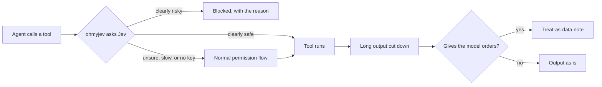

<p align="center">
  <picture>
    <source media="(prefers-color-scheme: light)" srcset="docs/logo-light.png">
    
  </picture>
</p>

<p align="center">
  <a href="https://typesafe.ai">Jev</a>, batteries included, for Claude Code, Codex, pi, and omp.<br>
  Your coding agent, faster and safer. Safe commands skip the prompt, long output gets cut down, compaction takes a
  second. GitHub changes get a reminder to the agent. Blocking security gates require opt-in lockdown mode.
</p>

<p align="center">
  
  
  
  <a href="https://www.npmjs.com/package/ohmyjev"></a>
  
</p>

<p align="center">
  <a href="https://ohmyjev.xyz"><b>ohmyjev.xyz</b></a> ·
  <a href="#quick-start">Quick start</a> ·
  <a href="#what-you-get">What you get</a> ·
  <a href="#install">Install</a> ·
  <a href="#using-it">Using it</a> ·
  <a href="#settings">Settings</a> ·
  <a href="#privacy">Privacy</a> ·
  <a href="#troubleshooting">Troubleshooting</a>
</p>

---

Jev is TypeSafe's decision model. You send it a few typed questions and it sends back probabilities in about 160 ms,
for about $0.00003 a call. That's cheap enough to ask about every step your agent takes, so ohmyjev does. It runs as
hooks inside your agent, with no server to run.

Normal mode keeps the speed features and output checks, with a local reminder before recognized GitHub changes.
Enable `lockdown` when you want OMJ to deny destructive commands, restrict writes and check data uploads.
Lockdown is off by default, including for existing installations with individual gate settings enabled.

## Quick start

```bash
export TYPESAFE_API_KEY=ts_...     # in your shell profile
```

Then in Claude Code:

```
/plugin install ohmyjev --marketplace Novacon/ohmyjev
/omj
```

If `/omj` ends with `key: env TYPESAFE_API_KEY`, you're set. Codex, pi, and omp are under [Install](#install).

## Default behavior

| | Normal mode, the default | Lockdown, opt in with `lockdown: true` |
|---|---|---|
| Commands and writes | OMJ's security gates are inactive. The agent's usual permissions still apply. | Enabled gates can deny destructive commands, writes outside allowed paths, credentials and data uploads. |
| GitHub changes and workflow runs | A reminder asks the agent to double-check. The first call does not run; repeating the same call proceeds after review. | The configured security gates decide. |
| Unverified "done" | The done-check does not push back. | The done-check can push back once per request. |
| Routing, injection notes and auto-compaction | On by default. | On by default. |

The GitHub reminder goes to the agent. It does not require asking you for approval when the action is already
authorized. Recognized reads, including `gh pr view` and `gh run list`, pass through. Set `githubReminders: false`
to disable the reminders. They work without a Jev key.

### Lockdown mode

For the current session, run `/omj config lockdown on`. To keep it enabled in Claude Code, use
`/plugin configure ohmyjev@ohmyjev`, then `/reload-plugins`. For omp:

```bash
omp plugin config set ohmyjev lockdown true
```

For Codex, add `"lockdown": true` to `~/.codex/ohmyjev.json`. For pi, set `"lockdown": true` under `ohmyjev` in your settings. Each gate's own toggle and thresholds still apply.
Set `lockdown` back to `false` to return to normal mode.

## What you get

### Faster

| | |
|---|---|
| **Auto-approve** | When Claude Code or Codex would ask you, a command Jev is sure is safe just runs, and so does an edit in the repo with no key in it. `ls`, `git status`, and `grep` skip Jev entirely. Off while you have `policies` set. |
| **Fast compaction** | Jev keeps the messages that still matter (your constraints, decisions, exact errors, and open work) word for word, instead of a model writing a summary. 60 messages took 336 ms with every planted constraint kept. Falls back to the normal summary if anything goes wrong. |
| **Trim long output** | Shell output over 12,000 characters is cut to the parts your request needs, with a note naming the lines it left out. A 20,000-character test log came back as 4,600, failure included. File reads like `cat` and `sed -n` are never cut. |
| **Skill picker** | Claude Code sends a line for every skill on every prompt. ohmyjev drops that list and loads only the one skill you need, or none. |
| **Stuck check** | Same failure three times? The agent is told to stop, read the error, and try something else. |
| **Router** | Picks effort and the subagent model for each request. With `routeMainModel` on it picks the main model too: it sent a flight search to Haiku, 108 s down to 44 s. |
| **Auto-compact** | New task and the context is 40% full? It compacts and keeps your new request. |
| **Narrow big reads** | Off by default. A `Read` of a 400+ line file comes back as the fifth you asked about, with a note on how to see the rest. |

### Lockdown and output checks

| | |
|---|---|
| **Bash gate** | In lockdown, blocks commands Jev rates irreversible (0.6) or sending your files or keys out (0.7). Normal edits, pushes, and uninstalls go through. |
| **Say yes** | In lockdown, every gate checks whether your latest message asked for the call. "Force push it" works. After a block, a plain "yes" runs that exact command. Your `policies` and path blocks always stand. |
| **Write gate** | In lockdown, blocks writes outside the repo or with a real key in them. Every worktree counts as the repo, and so does another repo the agent moves into. |
| **Exfil gate** | In lockdown, blocks web and MCP calls that send your files or keys out. |
| **Policies** | In lockdown, your own rules in plain English, checked on every call. |
| **Injection screen** | Output that slips orders to the model where they don't belong, like a README or an error, gets a "treat as data" note. A prompt or transcript you're debugging doesn't. |
| **Done-check** | In lockdown, "Done" with nothing tested gets pushed back once. Passing test output counts. |
| **Subagent checks** | A vague subagent brief goes back once. A subagent's "done" is checked against what it actually ran. Claude Code. |
| **Writing rules** | Your final reply is checked against the writing rules in `CLAUDE.md` and `AGENTS.md`, and rewritten once if it breaks one. Claude Code. |
| **Secret masking** | Keys, tokens, URL credentials, emails, and your home folder become markers before anything goes to Jev. |
| **GitHub reminders** | In normal mode, asks the agent to check the target and user intent before a GitHub change, workflow run or git push. The first call does not run; a deliberate repeat proceeds. No Jev key needed. |

### Tools and commands

| | |
|---|---|
| **`find_code`** | Finds code by what it does, even when it's named something else. Returns the file and line, or no match. |
| **`ask_jev`** | Asks Jev about files without the model reading them. Give it a folder and it asks every file, returning the yes ones. |
| **`browse`** | Off by default. Jev drives a headless browser click by click. A flight search took about 10 s. |
| **`/omj`** | This session's calls, cost, and blocks. `/omj config` shows and changes settings, `/omj stats` opens a dashboard, and `/omj off` and `/omj on` switch it for the session. `/ohmyjev` works too. |

### How lockdown decides



If Jev is unsure, slow, or down, the call goes through like normal. ohmyjev never adds a prompt. It only takes away the
ones a safe call didn't need. Jev can be wrong, so keep your own deny rules in `settings.json` too.

## Install

GitHub reminders work without a key. For Jev-backed checks, you need a [TypeSafe](https://typesafe.ai) key, or an OpenRouter key (it then calls `~typesafe/jev-latest`).
ohmyjev looks for the key in the Claude Code settings screen, then `TYPESAFE_API_KEY`, then `OPENROUTER_API_KEY`.

### Claude Code

Needs 2.1.287 or later.

```
/plugin install ohmyjev --marketplace Novacon/ohmyjev
```

Answer `y` and pick a scope. Hooks start right away. From a shell instead:

```bash
claude plugin marketplace add Novacon/ohmyjev && claude plugin install ohmyjev@ohmyjev
```

### Codex

```bash
codex plugin marketplace add Novacon/ohmyjev && codex plugin add ohmyjev@ohmyjev
```

Then run `/hooks` once to trust ohmyjev. It needs Node. Codex hooks can't add tools or change the model, so there's no
router, `/omj`, `ask_jev`, or `browse` there. Settings go in `~/.codex/ohmyjev.json`:

```json
{ "requested": 0.9, "policies": "never touch the prod cluster" }
```

### omp

```bash
omp plugin install ohmyjev
omp plugin config set ohmyjev routeMainModel true     # settings
```

Restart the session after installing. The router uses omp's `@smol`, `@default`, and `@slow` roles.

### pi

```bash
pi install npm:ohmyjev
```

Settings go under `ohmyjev` in `~/.pi/agent/settings.json`, or `.pi/settings.json` for one project:

```json
{ "ohmyjev": { "routeMainModel": true, "fastModel": "anthropic/claude-haiku-5-5" } }
```

Running Claude Code inside pi through pi-claude-bridge? pi runs every tool, so pi's copy of ohmyjev checks them and the
Claude Code copy stands down for the session: it sees pi's `OHMYJEV_PI`, registers no tools, and gates nothing. The
`/omj` you type in pi is the one that counts.

### By host

| | Claude Code | Codex | omp | pi |
|---|---|---|---|---|
| Gates, say yes, injection screen | yes | yes | yes | yes |
| Done-check, stuck check, trim | yes | yes | yes | yes |
| Auto-approve | yes | yes | omp doesn't ask | pi doesn't ask |
| Fast compaction | yes | no | no | yes |
| Router | yes | no | yes | yes |
| Skill picker, subagent checks, writing rules, read narrowing | yes | no | no | no |
| `/omj`, `ask_jev`, `find_code`, `browse` | yes | no | yes | yes |

## Using it

### Before a GitHub change

In normal mode, recognized GitHub writes, workflow runs and git pushes return an agent-visible reminder once per
distinct call in the session. It asks the agent to check the repository, branch, target and intended effect. The call
has not run yet. If it is already authorized and correct, the agent repeats it to proceed. Read operations such as
`gh pr view` and `gh run list` pass through. Set `githubReminders` to `false` to turn this off.

This is a convenience checkpoint. It recognizes common CLI commands and GitHub tools; it does not parse every shell
program or alias. Lockdown mode uses the security gates instead.


### When something gets blocked in lockdown

The agent gets the reason and a way out:

```
ohmyjev blocked this: irreversible (0.95): nothing would restore what this removes or overwrites.
Do not try to work around it with another command, another tool, a different path, or an encoding that does
the same thing. Tell the user what was blocked and why, and ask whether to run it anyway. If they say yes, run
exactly this again: their reply then lets it through.
```

Answer "yes" and that exact command runs. "No", or a yes followed by a different command, stays blocked. A write
outside the repo names the folder and asks you to add it to `allowPaths`.

### `find_code` and `ask_jev`

`find_code` searches by meaning. On this repo, "the code that stops the agent from writing outside the project" found
the write gate's path check, though the code never says that. "stripe billing webhook" found nothing, which is right.

`ask_jev` answers a question about files without the model reading them:

```json
{ "question": "Does this build SQL by string concatenation?", "type": "noul", "folder": "src/db" }
```

With a `folder`, it asks every source file and returns only the yes ones, with the line. Files outside the repo are
never sent.

### `browse`

Turn it on with `/omj config browse on`. Give it a URL, one goal, and the words it may type:

```json
{
  "url": "https://www.google.com/travel/flights?hl=en",
  "goal": "Find one-way flights from Zurich to London on November 20, 2026. Stop when flights show.",
  "values": ["Zurich", "London", "Nov 20, 2026"]
}
```

Jev picks each click and puts each value in the right field. It runs
[browser-use/jev-ultrafast](https://github.com/browser-use/jev-ultrafast) through [uv](https://docs.astral.sh/uv), in
its own headless browser that's signed in to nothing. Set `CHROME_PATH` to pick the browser.

### `/omj`

```
jev ✓23 ⛔1 ↑opus/high
calls 23 · errors 0 · cost $0.000966 · p50 310ms
denies: Bash 1
  Bash: irreversible (0.95): nothing would restore what this removes or overwrites
key: env TYPESAFE_API_KEY · typesafe · jev-1.13.0
```

`/omj config` shows the settings by section, one line each: `jev`, `gates`, `checks`, `speed`, `compaction`, `router`,
`tools`, and `display`. `/omj config gates` opens one, thresholds included, and `/omj config <name> <value>` changes
one for the session. A `*` marks a value that differs from the default. `/omj stats` opens a dashboard of every session
at `~/.ohmyjev/dashboard.html`. `/omj off` turns everything off for the session.

### Your own rules

In lockdown, put rules in `policies`, separated by `;`, and each enabled gate checks calls against them:

```
never touch the prod cluster; no deploys on Friday; don't edit migrations that already ran
```

### Status line

```
jev ✓23 ⛔1 ↑opus/high 🗜2     calls, blocks, this turn's route, compactions
jev ⚠ down                    Jev failed in the last 5 minutes, so calls go through
jev ⚠ no key                  no key found
jev off                       turned off for this session
```

To put it in your own statusline script, copy `jev_segment()` from
[`extras/statusline_segment.py`](extras/statusline_segment.py). Turn the built-in one off with `statusLine`.

## Settings

`/omj config` shows the settings by section, and `/omj config <section>` lists one. Change any setting for the session
with `/omj config <name> <value>`. To keep it, use `/plugin configure ohmyjev@ohmyjev` then `/reload-plugins` in Claude
Code, `omp plugin config set` in omp, or each host's settings file. The host dialogs list the settings in the same order:
switches first, thresholds after, section by section.

| Setting | Default | What it does |
|---|---|---|
| `lockdown` | off | Enables blocking bash, write, exfiltration and done-check gates. |
| `githubReminders` | on | In normal mode, reminds the agent once per distinct GitHub change. Set off to disable. |
| `enabled` | on | Everything. `/omj on` and `off` for one session. |
| `autoApprove` | on | Skips the prompt for safe calls. `approveConfidence` (0.9), `approveRiskMax` (0.2). |
| `fastCompact` | on | Jev keeps the messages that matter instead of a model summary. |
| `trimOutput` | on | Cuts long shell output. `trimOver` (12000), `trimKeep` (0.3). |
| `skillPick` | on | Loads only the skill you need. `skillGate` (0.3), `skillMin` (0.4). |
| `stuckCheck` | on | Catches the agent repeating a failure. `stuck` (0.7). |
| `routeEffort`, `routeSubagents` | on | Lets the router set effort and the subagent model. |
| `routeMainModel` | off | Also switches the main model, which drops the prompt cache. |
| `routeWithoutKey` | on | With no key, the host's own classifier routes, up only. |
| `autoCompact` | on | Compacts on a new task once the context is `compactMinPercent` (40) full. |
| `readNarrow` | off | Cuts a big `Read` to the part you asked about. |
| `bashGate`, `writeGate`, `exfilGate` | on in lockdown | Each gate. |
| `requested` | 0.8 | How sure Jev must be that you asked for a blocked call. |
| `policies` | empty | Rules for enabled lockdown gates, separated by `;`. |
| `allowPaths` | `~/.claude;$TMPDIR;/tmp` | In lockdown, places outside the repo it can write to. |
| `injectionScreen`, `screenReads` | on | Flags output that gives the model orders. |
| `doneCheck` | on in lockdown | Pushes back once on an unchecked "done". |
| `subagentCheck` | on | Checks vague subagent briefs and subagent results. |
| `proseCheck` | on | Checks replies against the writing rules in `CLAUDE.md` and `AGENTS.md`. |
| `maskSecrets` | on | Masks secrets before anything goes to Jev. |
| `askJev`, `findCode` | on | The `ask_jev` and `find_code` tools. |
| `browse` | off | The `browse` tool. Needs uv. |
| `fastModel`, `balancedModel`, `deepModel` | `claude-{haiku,sonnet,opus}-5-5` | The model for each router tier. |
| `jevModel` | `jev-1.13.0` | The Jev model. |
| `timeoutMs` | 1500 | How long to wait for Jev before letting a call through. |
| `logDecisions`, `statusLine` | on | Decision lines in the transcript, and the status under the prompt. |

## Privacy

GitHub reminders run locally and make no Jev calls. With lockdown off, enabled auto-approval may still judge commands
and in-repo edits, but those judgments cannot deny them. Other enabled output and quality checks keep their own settings.

Each check sends Jev only what it needs, cut to size, with secrets masked first. With no key, nothing goes.

| Check | What it sends |
|---|---|
| Bash gate | The command (16,000 characters), working directory, description, and your latest message. Plain reads send nothing. |
| Write gate | The path and new content (16,000). In lockdown, writes outside the repo are blocked before anything is sent. |
| Exfil gate | The tool name and input (4,000). |
| Injection screen | The tool output (6,000). |
| Done-check | The request, five earlier ones, this turn's tool calls with the end of each output, and the last reply. |
| Trim, stuck check | Your latest message, plus the long output or the last six failed calls. |
| Fast compaction | Recent messages in groups of 10, each cut to 1,200 characters. |
| Skill picker | Each prompt with every skill's name and one-line description. |
| Writing rules | Each final reply (6,000). The rules are pulled from your instruction files once, by Haiku inside Claude Code. |
| Router | The request (1,500). |
| `ask_jev`, `find_code` | The question and repo files. Never files outside the repo. |
| `browse` | The goal, then each page's controls and visible text. |

Logs stay in `~/.ohmyjev`, readable only by you. They hold verdicts, probabilities, latency, and cost, never your
commands' output.

## Update or remove

```bash
claude plugin update ohmyjev@ohmyjev       # then restart; or: claude plugin uninstall ohmyjev@ohmyjev
codex plugin marketplace upgrade ohmyjev   # then trust the changed hooks in /hooks; or: codex plugin remove ohmyjev@ohmyjev
omp plugin upgrade ohmyjev                 # or: omp plugin uninstall ohmyjev
pi update npm:ohmyjev                      # or: pi remove npm:ohmyjev
```

## Troubleshooting

**`jev ⚠ no key`.** Set `TYPESAFE_API_KEY` in the shell that starts your agent, or enter it with `/plugin configure
ohmyjev@ohmyjev`.

**GitHub reminder.** The call has not run. The agent can check the target and existing authorization, then repeat the
same call to proceed. This reminder alone does not require asking you. Set `githubReminders` off to disable it.

**`jev ⚠ down`.** Jev failed or took over 1.5 s in the last 5 minutes. Calls go through until it's back.

**Blocked by mistake in lockdown.** Say yes and it runs. `/omj` shows why. Raise that gate's threshold, turn it off, or `/omj off`
for the session. Local MCP tools sometimes trip `exfilGate`.

**Nothing happens.** The first transcript line should start with `[ohmyjev]`. If not, run `claude --debug` to see which
hook failed.

## Develop

```bash
git clone https://github.com/Novacon/ohmyjev && cd ohmyjev && bun install
claude --plugin-dir "$PWD"                  # or: omp -e ./adapters/omp.ts, pi -e ./adapters/pi.ts
bun run test && bun run typecheck && claude plugin validate .
bun tests/live.ts                           # 28 real commands against the live Jev
bun tests/live-screen.ts                    # 11 outputs against the injection screen
```

The decisions live in `hooks/policy.ts`, plain functions tested with tables. `hooks/ohmyjev.ts` wires them to Claude
Code, and `adapters/` to Codex, omp, and pi.

## Credits

Question rubrics from [disler/ten-levels-of-jev](https://github.com/disler/ten-levels-of-jev). `browse` runs
[browser-use/jev-ultrafast](https://github.com/browser-use/jev-ultrafast). `find_code`, folder sweeps, and read
narrowing are ported from [BorisLeMeec/jev](https://github.com/BorisLeMeec/jev). Fast compaction follows
[0x7067/claude-jev](https://github.com/0x7067/claude-jev), subagent checks
[austpryb/jev-hooks](https://github.com/austpryb/jev-hooks), the writing-rule check
[vgeshel/prose-check](https://github.com/vgeshel/prose-check), and masking
[tsetse012/jev-hook-guard](https://github.com/tsetse012/jev-hook-guard). All MIT.
